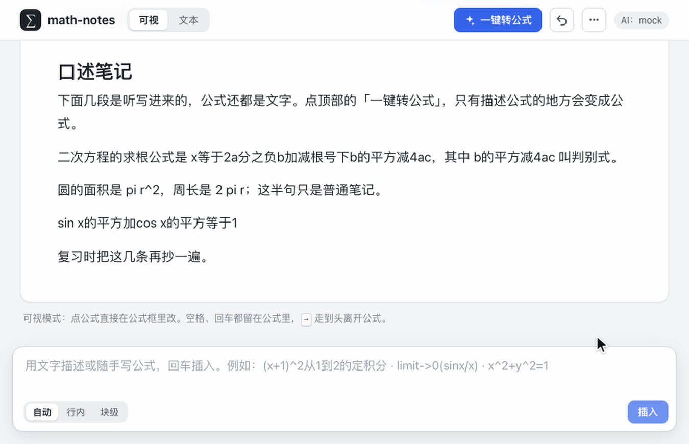
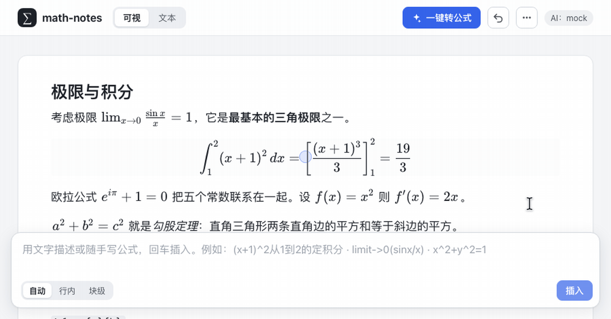
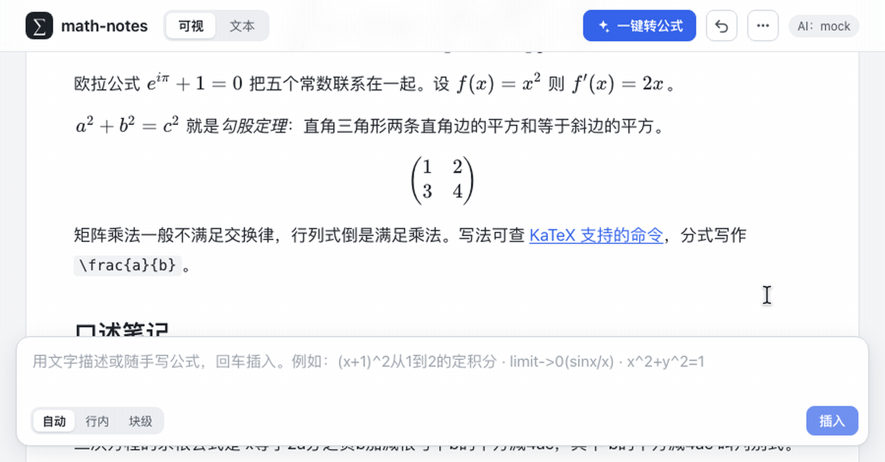
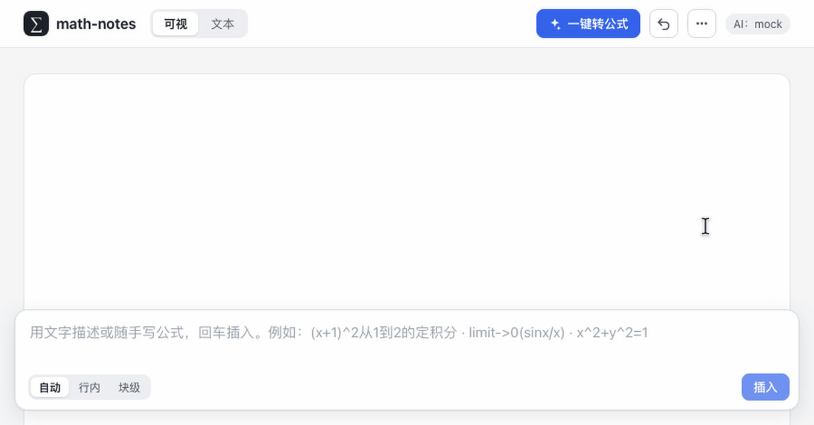

# math-notes

AI 辅助的"公式 + 文字"笔记组件。底部输入模糊描述或不精准公式，AI 只产出公式；公式渲染后可直接点进去结构化编辑，也能切到 LaTeX 源码改；听写进来的笔记可以一键把公式描述换成公式。将来复用到 learning-oj。



> 动图录自 playground，AI 用的是内置 mock（`pnpm dev` 默认，不需要密钥），每次录出来都一样。接真实 DeepSeek 的效果见 [S4 AI 语料评测](docs/spikes/S4%20AI%20语料评测.md)。

## 演示

### 用文字描述公式

在底部输入框写描述或随手写的公式，回车插入到笔记的光标处。AI 只回公式；拿不准时说明按哪种理解，另一种读法一点就换。

- 显式 LaTeX（如 `x^2+y^2=1`）直接插入，不调 AI。
- AI 给的公式 KaTeX 渲染不过时，带着报错重试一次；仍不行就不插入，原文保留。
- 超出渲染范围的内容（如交换图）提示是能力边界、不是识别错误，原文保留。


### 点公式直接改

渲染后的公式点哪改哪：点 `lim` 下标里的 0，光标就落在那里，原地结构化编辑。方向键走到头离开公式、回到正文，一次编辑是一步撤销。行内公式的编辑方式（就地编辑、浮层覆盖、下方弹层）在顶栏「⋯」里切换。



### 文本模式

顶栏切到「文本」，点公式显示 LaTeX 源码，下方弹窗实时预览；写错时预览变淡，并提示第几个字符附近出错。选择会被记住。



### 像 Typora 一样写

Markdown 语法照打，光标所在处显示 `##`、`**` 等标记；`$…$` 直接变成公式，空行里打 `$$` 开一个块级公式。选中文字会出现「转为公式」气泡（<kbd>⌘/Ctrl</kbd> <kbd>⇧</kbd> <kbd>E</kbd>）：选中的正好是一个公式（LaTeX 或 `sin x` 这类随手写法）就整体转换，否则只替换其中描述公式的部分。



## 快捷键

| 按键 | 作用 |
|---|---|
| <kbd>⌘/Ctrl</kbd> <kbd>⇧</kbd> <kbd>E</kbd> | 选中文字里的公式描述转成公式；没选中时插入一个空公式 |
| `$…$`、空行里 `$$` | 打字输入行内公式、块级公式 |
| `#`、`**`、`>` | Markdown 语法照打；标题开头退格删掉 `#` 后的空格 |
| <kbd>→</kbd> <kbd>←</kbd> | 公式里走到头就离开公式 |
| <kbd>Enter</kbd> | 块级公式里换行；行内公式里完成 |
| <kbd>Esc</kbd> | 完成编辑 |
| <kbd>⌘/Ctrl</kbd> <kbd>Z</kbd> | 撤销；一次公式编辑、一次整篇转换都只算一步 |
| <kbd>⌘/Ctrl</kbd> <kbd>C</kbd> | 复制；纯文本里行内公式写成 `$…$`、块级公式上下各一行 `$$`，点开的公式里复制的是 LaTeX 源码；粘回笔记都还是公式 |
| <kbd>⌘/Ctrl</kbd> <kbd>V</kbd> | 粘贴；往文本模式的源码里粘 `$…$` 这类带定界符的公式，定界符自动去掉 |

## 命令

```bash
pnpm install
pnpm dev                                  # 打开 http://localhost:5180，AI 为 mock
DEEPSEEK_API_KEY=... DEEPSEEK_MODEL=... pnpm dev   # 真实 AI，密钥只留在 dev server 里（Claude 预览里用 playground-ai 配置，读 spikes/s4-ai-corpus/.env）
pnpm -r --if-present test                 # 单元测试
pnpm -C apps/playground test:e2e          # Playwright 回归（首次先 pnpm -C apps/playground exec playwright install chromium）
pnpm -C apps/playground demo              # 重录 README 动图到 docs/media（需要 ffmpeg；只录一段加 -g describe）
pnpm -r --if-present typecheck
cd spikes/s4-ai-corpus && pnpm eval       # AI 语料评测，密钥读环境变量或该目录的 .env，结果在 results/
```

## 结构

```
packages/core       纯 TS 核心：意图分类、MathLive 适配层、KaTeX 渲染、Tiptap 公式节点、AI 契约与 DeepSeek 适配器
apps/playground     Vite + React 演示与实验台，含 Playwright 回归（e2e/）和 README 动图的录制脚本（demo/）
spikes/s4-ai-corpus AI 语料评测器（需要你的 DeepSeek 密钥）
docs                设计、调研、spike 结果；media/ 是 README 动图
```

## 设计

核心思路是不要求一种表示同时适合存储、显示、编辑和 AI 理解：LaTeX 字符串保存公式，ProseMirror（经 Tiptap）保存文档结构，KaTeX 负责显示，MathLive 负责结构化编辑（经一层适配接入，锁版本加升级回归），一份线性文本投影给 AI 读。AI 是注入的函数，只回结构化结果；KaTeX 校验、重试和歧义暴露都在宿主这边做。

- [设计稿](docs/design/设计稿.md)：当前设计（v0.3，七项决策已定）
- [调研报告](docs/research/调研报告.md)与[六份笔记](docs/research/notes)
- 各轮实测：[S1 行内编辑三档实测](docs/spikes/S1%20行内编辑三档实测.md)、[S2 IME 矩阵清单](docs/spikes/S2%20IME%20矩阵清单.md)、[S4 AI 语料评测](docs/spikes/S4%20AI%20语料评测.md)

## 进度

- S0 输入意图分类器：完成，63 例。
- S1 行内编辑三档实测：完成，21 个回归用例通过；结论见 [S1 行内编辑三档实测](docs/spikes/S1%20行内编辑三档实测.md)。
- S2 IME 矩阵：清单已写，待人工执行。
- S4 AI 语料：完成三轮。deepseek-flash 必须关闭思考（适配器已默认关闭）；开发集 97 条、留出集 75 条各跑三轮全过，歧义暴露 10/10、17/17，完整结果 p50 0.82 s；结论见 [S4 AI 语料评测](docs/spikes/S4%20AI%20语料评测.md)。
- 编辑体验：Typora 式 Markdown（光标所在处显示 `##`、`**` 等标记，标题开头退格删空格改级别）、文本模式（点公式变 LaTeX 源码、弹窗实时预览）、选中文字的"转为公式"气泡与整篇一键转公式（都只替换公式描述，AI 只回逐字引文，宿主定位替换）；`\lim` 行内编辑与渲染不一致已修；公式里空格、回车留在公式内，方向键走到头离开；复制时公式在纯文本里写成 `$…$`、`$$…$$`，公式里复制的 LaTeX 粘回笔记仍是公式。回归 48 个用例（`e2e/s1.spec.ts`、`e2e/editing.spec.ts`、`e2e/markdown.spec.ts`、`e2e/clipboard.spec.ts`）。
- S3 能力语料、S5 安全语料、S6 性能：未开始。
